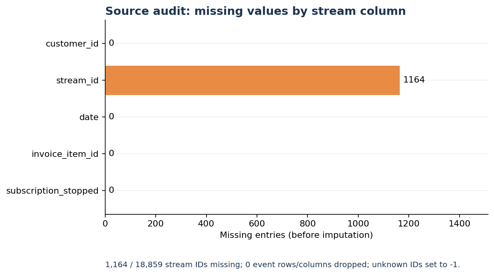
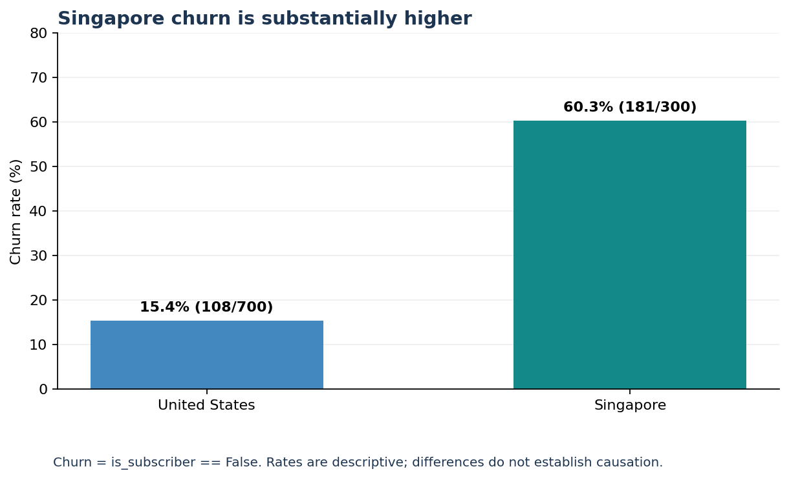
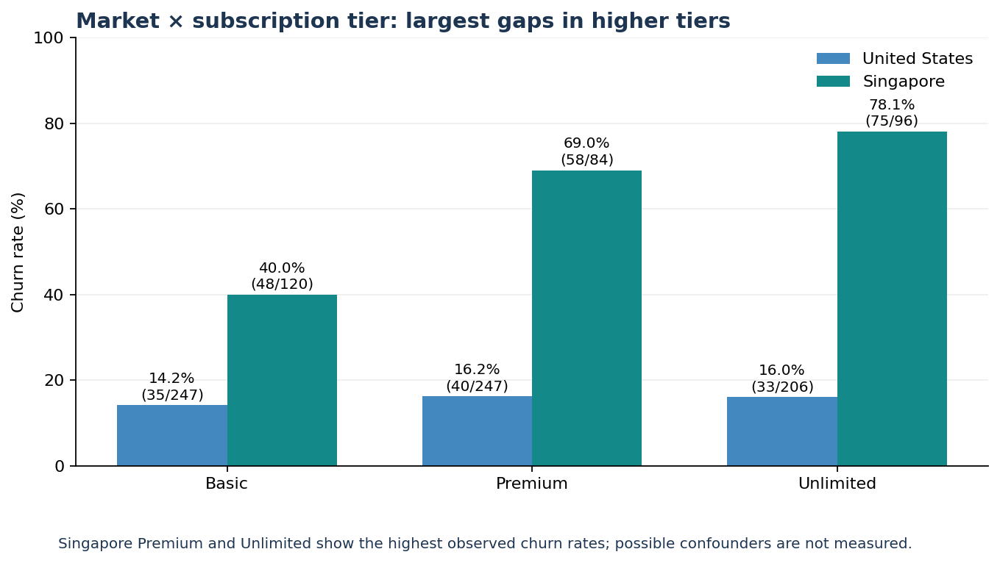
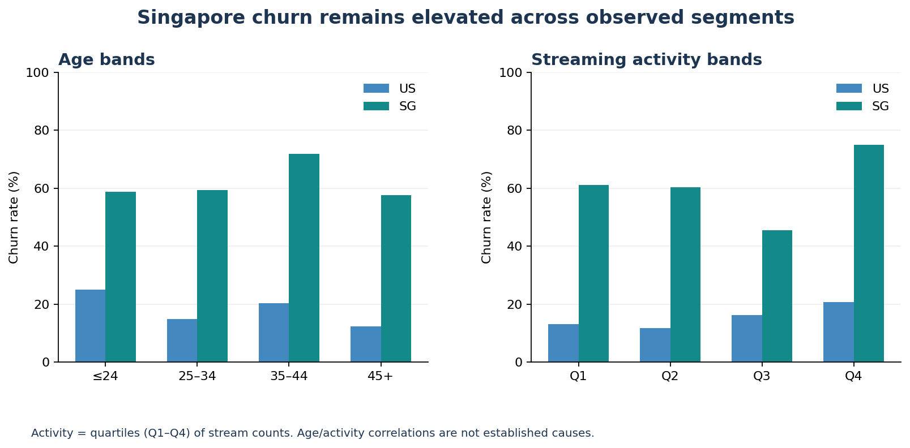
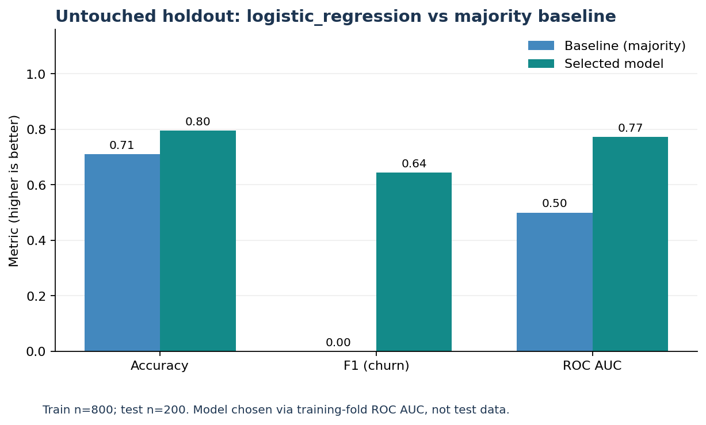

# AAVAIL Customer Churn Prediction: End-to-End Machine Learning Deployment and Monitoring

**Coursera Capstone | Data ingestion · EDA · Model comparison · REST API · Testing · Monitoring · Docker**

This repository provides a reproducible example of a customer-churn prediction service using the earlier AAVAIL case-study data. It explicitly audits missing values when the data are ingested, investigates Singapore's churn disparity, trains and compares multiple models, exposes a working prediction API, logs requests, and supports ongoing model-performance monitoring.

> **Scope / integrity:** This is a coursework demonstration, not a deployed production service. The included data are a minimally anonymized version of the supplied AAVAIL case-study customer table and its stream events. No real-world causal claim, external production infrastructure, or successful Docker Engine runtime is asserted.

## 1. Executive summary

- **1,000 customers:** 700 United States and 300 Singapore.
- **18,859 stream events:** 1,164 missing `stream_id` values (6.17%); no other source null values.
- **Imputation:** preserve all events and fill unknown categorical `stream_id` with `-1`, retaining `stream_id_was_missing=True` for auditability. **0 stream rows and 0 stream columns dropped.**
- **Churn:** Singapore **181/300 (60.3%)**, US **108/700 (15.4%)**. Higher Singapore churn occurs in all plans, especially Premium and Unlimited.
- **Model selection:** 5-fold CV within an 800-customer training partition, followed by evaluation on 200 untouched holdout customers.
- **Selected model:** Logistic Regression, holdout **accuracy 0.795**, **F1 0.643**, **ROC AUC 0.773**; majority-class baseline **accuracy 0.710**, **F1 0**, **ROC AUC 0.5**.
- **Tests:** run `python run_tests.py` to execute API, ingestion, model, logging, and monitoring tests in one command.

## 2. Project architecture

```text
                         data/aavail-customers-anonymized.csv
                         data/aavail-streams.csv
                                      |
                        aavail/ingestion.py  (audit & impute)
                                      |
                         artifacts/customer_features.csv
                                      |
               +----------------------+----------------------+
               |                      |                      |
    aavail/visualizations.py   aavail/training.py     artifacts/audit.json
         EDA charts           CV, 3 models, test            |
               |                      |                      |
       artifacts/figures/     artifacts/churn_model.joblib  |
                                      |
                               aavail/api.py
                                      |
                        GET/POST /predict, /health, /metrics
                                      |
                      aavail/logging_utils.py + monitoring.py
```

The public customer source deliberately omits the original `customer_name` field. The original customer-level case-study table had 7 columns; the published anonymized CSV has 6. Removing that identifying field is a **pre-publication privacy choice**, not an imputation or missing-data fix.

## 3. Data ingestion, missingness and dropped columns

Run:

```bash
python scripts/run_pipeline.py
```

The function `ingest_data(customers_csv, streams_csv, output_dir)`:

1. Loads source CSVs and **audits null counts before modifying the data**.
2. Enforces required schema, non-null keys, unique customer keys, known references, dates, and valid target labels.
3. Flags unknown content identifiers with `stream_id_was_missing` and fills those identifiers with sentinel **-1** (unknown, not a real stream ID).
4. Retains **all 18,859 stream events** and builds one record per customer with stream-event counts and missing-ID rates.
5. Exports a JSON audit, imputed stream rows, and customer features; never modifies the source CSVs.

| Source / step | Rows | Missing fields | Rows dropped | Columns dropped |
|---|---:|---|---:|---:|
| Anonymized customers (published source) | 1,000 | None | 0 | 0 |
| Stream events (original source) | 18,859 | `stream_id`: 1,164 | 0 | 0 |
| Stream events after imputation | 18,859 | None | 0 | 0 |
| Customer features after join | 1,000 | None | 0 | 0 |

**Model inputs excluded from training:** `customer_id` (identifier), `is_subscriber` and `churned` (outcome/target leakage), plus event-only fields `stream_id` and `subscription_stopped` (not customer-level predictors). Model features are `country_name`, `subscriber_type`, `age`, and `num_streams`. The `stream_id` missingness indicator is maintained for QA but not used as a predictor. Churn is defined **only** as `is_subscriber == False`.

> We do not assume the missing identifiers are Missing Completely At Random (MCAR). An average/median stream ID would fabricate an identifier rather than reconstruct content.

Artifacts: [`artifacts/audit.json`](artifacts/audit.json), [`artifacts/streams_imputed.csv`](artifacts/streams_imputed.csv), [`artifacts/customer_features.csv`](artifacts/customer_features.csv).

## 4. Exploratory visualizations: understanding the Singapore situation

### Figure 1 · Missing values at ingestion



**Description:** Exactly 1,164 `stream_id` entries are null (6.17% of all stream events). The other four stream columns are complete. Events are preserved with explicit unknown-ID labeling so missing data are not silently discarded.

### Figure 2 · Churn disparity by market



**Description:** Singapore's 60.3% observed churn rate exceeds the US rate of 15.4% by **44.9 percentage points**. This is a descriptive association, not proof that geography caused cancellation.

### Figure 3 · Country × subscription tier



**Description:** The observed churn rates are approximately **40.0% / 69.0% / 78.1%** for Singapore Basic / Premium / Unlimited, versus **14.2% / 16.2% / 16.0%** in the US. The conspicuous **Singapore × high-tier** pattern is a key investigation priority. The data lack billing, pricing, content availability, acquisition channel, and cancellation reasons needed to establish why.

### Figure 4 · Age and viewing activity segments



**Description:** Singapore churn remains higher across age and stream-activity bands, making a simple demographic or engagement composition explanation less persuasive. These are **observed correlations**, not independent causal effects; stream counts may themselves be affected by subscription termination.

## 5. Model training and baseline comparison

`aavail/training.py` compares:

| Model | 5-fold train-only CV ROC AUC (mean) |
|---|---:|
| Majority-class baseline | 0.500 |
| Logistic Regression | 0.750 |
| Random Forest | 0.714 |

A fixed random seed (`42`) and **stratified 80/20 train/test split** are used. Model selection happens on training-only cross-validation scores. The 200-customer test split is untouched until after selection.

### Figure 5 · Selected model vs baseline, same holdout



**Description:** Logistic Regression improves on the majority-class baseline for accuracy, F1, and ROC AUC on the held-out split. Its holdout accuracy is **0.795** compared with **0.710**, and holdout ROC AUC is **0.773** compared with **0.500**. See [`artifacts/model_metrics.json`](artifacts/model_metrics.json) and [`artifacts/model_comparison.csv`](artifacts/model_comparison.csv).

**Important limitation:** Country-specific held-out ROC AUC is much weaker (**Singapore 0.567; US 0.532**), indicating the aggregate predictive result is driven substantially by broad between-market differences. The model should **not** be considered ready for individual retention decisions. Next steps include more data, calibration and validation against genuinely later customer cohorts.

## 6. REST API: all countries, specific country, individual predictions

Install dependencies once, then start the API:

```bash
python -m pip install -r requirements-dev.txt
python scripts/run_pipeline.py
uvicorn aavail.api:app --host 127.0.0.1 --port 8000
```

Open interactive documentation at <http://127.0.0.1:8000/docs>.

**GET `/health`** checks model and data presence. **GET `/metrics`** exposes API request counts, HTTP error counts, latency, and requests by route.

**GET `/predict`** scores the source customers, filtered by country, with pagination:

```text
http://127.0.0.1:8000/predict?country=singapore&limit=5
http://127.0.0.1:8000/predict?country=united_states&limit=5
http://127.0.0.1:8000/predict?country=all&limit=5
```

All-country response includes both market summaries and total **1,000** records; Singapore request includes **300**, and US includes **700**. The full population is evaluated even when only a page of prediction rows is returned.

**POST `/predict`** for an anonymous individual:

```bash
curl -X POST http://127.0.0.1:8000/predict \
  -H 'Content-Type: application/json' \
  -d '{"country_name":"singapore","subscriber_type":"aavail_premium","age":30,"num_streams":12}'
```

This returns `predicted_churn` and a churn probability. It does **not** require `is_subscriber` at inference time. Invalid countries, plans and feature values are rejected with HTTP 422.

## 7. Logging, monitoring and safe tests

### Unit tests (single command)

```bash
python run_tests.py
```

Tests live in `tests/test_api.py`, `tests/test_model.py`, `tests/test_ingestion.py`, `tests/test_logging.py`, and `tests/test_monitoring.py`. They cover country/all API predictions, response validation, preprocessing and holdout model artifacts, null handling, logging, and performance monitoring. **All tests use pytest `tmp_path` fixtures, synthetic records, and separate temporary model/log files; tests do not write to the prebuilt model or production log paths.** GitHub Actions runs these checks on each push.

### Structured logging

Every API request records a timestamp, route, HTTP status, and latency in `logs/api_events.jsonl` with rotation. Logs avoid names and raw feature payloads. The logger accepts an explicitly injected file path so unit tests cannot pollute production logs.

### Performance monitoring

- `GET /metrics`: in-memory operational monitoring (request count, errors, mean latency and endpoint traffic). Counters reset when the process restarts.
- `scripts/monitor_performance.py`: on a **new labeled customer batch** with `is_subscriber` available, calculates churn F1 and ROC AUC; flags ROC AUC drops greater than 0.10 relative to the original holdout score.

```bash
python scripts/monitor_performance.py --input path/to/NEW_LABELED_BATCH.csv --output artifacts/new_batch_monitoring.json
```

**Only independent, later observations support real post-deployment performance monitoring.** Re-scoring this repository's original data would be a code demo, not independent model validation. The repository includes the mechanism; no fictional live monitoring results are claimed.

## 8. Docker (single-container reproducible build)

```bash
docker build -t aavail-capstone .
docker run --rm -p 8000:8000 aavail-capstone
```

Docker installs dependencies, regenerates the ingestion/model/plots during image build, and launches the FastAPI app on port 8000 as a non-root user. Endpoints are then available at <http://localhost:8000/docs> and <http://localhost:8000/health>.

**Verification status:** Python pipeline and 13 pytest tests were executed successfully in the authoring environment. The Dockerfile and run instructions are included, but a live Docker Engine build/run was **not available for verification here**. Reviewers can build/run it themselves.

## 9. Recommendations for AAVAIL

1. **Investigate Singapore Premium / Unlimited churn** via cancellation reasons, customer interviews, payment failures, pricing/value and content localization comparisons.
2. **Instrument data quality** at ingestion; monitor missing `stream_id` rates by time/market and schema drift. Do not silently discard viewing events.
3. **Collect time-aware customer features**, including signup/cohort, price, transaction failures, recent engagement windows, cancellation date and acquisition source.
4. **Validate later cohorts** by country and plan; inspect precision/recall, calibration, and drift before choosing a production intervention threshold.
5. **Evaluate retention experiments** with randomized holdouts and business outcomes (incremental customer retention and revenue), rather than equating prediction quality with actual revenue lift.

## 10. Peer-review rubric checklist

| Peer-review item | Evidence |
|---|---|
| API unit tests | `tests/test_api.py` |
| Model unit tests | `tests/test_model.py` |
| Logging unit tests | `tests/test_logging.py` |
| Single test script, passing tests | `python run_tests.py` (13 passed in prepared environment) |
| Monitor performance | `GET /metrics` + `scripts/monitor_performance.py` |
| Isolated read/write tests | pytest `tmp_path`, synthetic fixtures, injected file paths |
| API predicts Singapore, US and all | `GET /predict?country=singapore`, `united_states`, `all` |
| Automated ingestion script/function | `scripts/run_pipeline.py` → `aavail/ingestion.py` |
| Multiple models compared | `aavail/training.py`; `artifacts/model_comparison.csv` |
| EDA includes visualizations | `artifacts/figures/01` to `04` PNG |
| Docker image definition | `Dockerfile` (build provided; actual Docker run not independently verified) |
| Visual baseline comparison | `artifacts/figures/05_model_vs_baseline.png` |

## 11. Reproducibility / limitations

- The dataset is from the user-provided Coursera AAVAIL case-study files. Published source customer names have been excluded before public distribution.
- `stream_id = -1` always means **unknown**, not an actual title. Missingness may not be random.
- Modeling uses country, subscription tier, age, and total stream count; some measurements may have been collected after churn. This is a **demonstration**, not a production-validated forecasting system.
- No customer revenue, pricing, tenure, billing failure or cancellation-reason fields were supplied. Causal explanations for Singapore churn cannot be inferred from these observations alone.
- Training saves `artifacts/churn_model.joblib`. Treat model pickle files as trusted executable artifacts and regenerate the model locally when in doubt.
